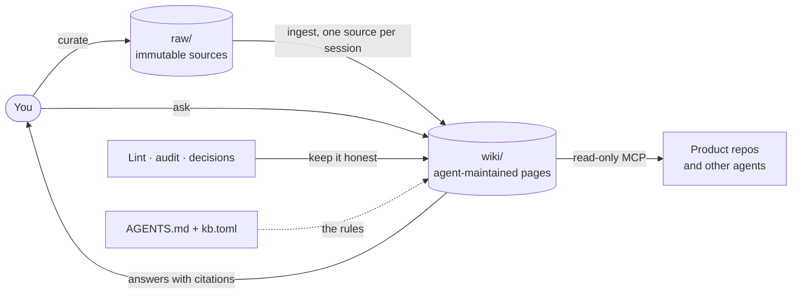

<div align="center">
  
  <h1>MycoForge</h1>
  <p>Grow a knowledge base that compounds. A template for Karpathy-pattern LLM wikis: you curate the sources, an AI agent keeps the wiki, and everything you build reads from it.</p>

  [](LICENSE)
  [](scripts/lint.py)
  [](https://obsidian.md)
  [](mcp/server.py)
</div>

## Why

Most AI setups start every question from zero: search the documents again,
answer, forget. MycoForge packages the
[LLM wiki pattern](https://gist.github.com/karpathy/442a6bf555914893e9891c11519de94f)
so the work adds up instead.

- **Knowledge is compiled once and kept current.** Each source is read in full
  and folded into pages that already exist, so the tenth source lands in a wiki
  that knows the first nine.
  ([Why LLM Wikis Beat RAG](wiki/syntheses/Why%20LLM%20Wikis%20Beat%20RAG.md))
- **The context is the part you keep.** Software built on top can be thrown away
  and regenerated; the decisions, playbooks and sources behind it can't.
  ([Company Brain](wiki/concepts/Company%20Brain.md))
- **You curate and decide; the agent does the upkeep.** Summarizing,
  cross-linking, indexing, logging and linting are the agent's job, every time.
  ([Three-Layer Architecture](wiki/concepts/Three-Layer%20Architecture.md))
- **The rules that matter are checked, not just requested.** Conventions live in
  a schema; a linter and an audit script check them.
  ([Advisory and Deterministic Controls](wiki/concepts/Advisory%20and%20Deterministic%20Controls.md))

It fits two shapes: a **personal second brain** (your research and reading,
compounding) and a **company playbook** (the decisions, processes and roles an
AI-native team's agents work from). Either way the knowledge base is plain
markdown in a git repo you own.

## How it works



Three layers, one ownership rule:

- **`raw/`** holds your curated sources (papers, articles, transcripts). The
  agent reads them and never modifies them.
- **`wiki/`** is agent-owned markdown: concept and people pages, syntheses, an
  `index.md` catalog, an append-only `log.md`. Obsidian is the IDE; the LLM is
  the programmer; the wiki is the codebase.
- **`AGENTS.md`** is the schema: the contract that makes the agent a disciplined
  wiki maintainer instead of a generic chatbot. `CLAUDE.md` is a symlink to it,
  so it works in Claude Code and Codex alike.

The full picture, with every workflow on it, is in [The Machinery](architecture/The%20Machinery.md). <!-- sf:keep-if(architecture) -->

MycoForge is the KB sibling of
[sporeforge](https://github.com/LukeMainwaring/sporeforge), the full-stack
AI-app template. Products come and go as separate sporeforge instances; the
knowledge base feeds them over MCP and outlives them.

## What's in the box

| Job | What does it |
|---|---|
| **Capture** sources into `raw/` | `/transcript`, `/snippet` (podcasts and video), `/research` (find sources for a question), `/scout` (standing watch for fresh ones) |
| **Compound** them into the wiki | Ingest, Query, `/connect` (bridges between weakly-linked pages) |
| **Keep it honest** | `scripts/lint.py`, `/audit` (one health report, never edits), claim callouts with a status, ADRs in `decisions/` |
| **Explain it** | `/architecture-guide` keeps diagrams of the machinery and of the content current |
| **Feed** other repos | Read-only MCP server: `search_kb`, `read_page`, `get_index` |
| **Maintain** the tooling | `/onboard`, `/sync-upstream` (template updates), `/sync-skills` (vendored skills) |

Plus a few utility skills: `/grill-me`, `/handoff`, `/teach`, `/pr`. Skills live
in `.agents/skills/`; the tooling is Python stdlib; every per-instance setting
is in `kb.toml`.

## The example you replace

The wiki in this repo is a live knowledge base, not a toy: it covers the
LLM-wiki pattern itself and AI-native ways of working, built up source by source
with the same workflows you'll use, and the template's own design decisions are
its ADRs. Read it to learn the conventions; every page obeys the schema.
Onboarding deletes it and seeds your domain in its place.

## Quick start

No stack to install: the KB is markdown plus Python stdlib. You need
[uv](https://docs.astral.sh/uv/) only if you keep the MCP server, and
[yt-dlp](https://github.com/yt-dlp/yt-dlp) only if you keep media capture.

MycoForge is a GitHub template repository. Create a new KB from it (a fresh
repo with its own history, not a fork):

```bash
gh repo create my-kb --template LukeMainwaring/mycoforge --private --clone
cd my-kb
```

Or click **Use this template → Create a new repository** on GitHub, then clone.

Then open an agent session (Claude Code or Codex) and type **`/onboard`**. The
skill interviews you for domain, identity, features and page types, runs the
deterministic prune, seeds your wiki, and cleans up after itself.

## Onboarding

The scaffold ships every feature on, then you **cut down** to what you want.
Six features can be cut; the wiki core always stays.

| Feature | What it is |
|---|---|
| `product` | Spec pages, roadmap, Home dashboard, for KBs that feed software (ADRs in `decisions/` always stay) |
| `orchestrator` | Parent-KB federation: children manifest, routing workflow, child-aware lint |
| `media-capture` | `/transcript` + `/snippet` for podcast and video sources |
| `insight` | `/research`, `/scout` and `/connect`, plus the `staging/` queues |
| `architecture` | `/architecture-guide` and the `architecture/` pages and diagrams |
| `mcp-server` | The read-only MCP feed |

`/onboard` opens by asking which shape you want, and a preset pre-fills the
features, page types and seed pages (every answer still overridable):

- **Personal second brain** keeps `media-capture` + `insight`; `mcp-server` and
  `architecture` are optional. Default `concepts/people/syntheses` page types.
- **Company playbook** keeps `product` + `mcp-server` + `insight` +
  `architecture`; `orchestrator` is optional, for multi-venture federation.
  Page types are `concepts/decisions/playbooks/roles`, seeded with a
  lifecycle-stage frame, a playbook template and a role template.
- **Custom** is the plain interview.

The CLI underneath the skill lives in [`.template/`](.template/README.md):

```bash
python3 .template/onboard.py --list                            # the cuttable features
python3 .template/onboard.py --keep media-capture,insight      # preview: second-brain preset
python3 .template/onboard.py --keep media-capture,mcp-server \
        --slug mykb --brand MyKB --apply                       # apply + rename
```

Feature-specific content is marked inline, so pruning is mechanical.
`.template/verify_matrix.sh` prunes six representative combinations and checks
each one lints clean, has no leftover markers, and passes the tooling tests.
`/onboard` deletes `.template/` when it's done.

Instances **vendor** their tooling (copy and own). Because per-instance data
lives in `kb.toml`, the code stays byte-identical across instances and
`/sync-upstream` can port template updates against the pinned
`template.version`.

## Feeding a product repo over MCP

`.mcp.json` (Claude Code) and `.codex/config.toml` (Codex) already register the
server for sessions opened in the KB. To attach the KB from a *product* repo,
add one entry to that repo's `.mcp.json`, pointing at the KB by absolute path:

```json
{
  "mcpServers": {
    "my-kb": { "command": "uv", "args": ["run", "/absolute/path/to/my-kb/mcp/server.py"] }
  }
}
```

The product session can then `search_kb`, `read_page` and `get_index`, and
never write: ingestion stays an interactive workflow inside the KB, by design
(see `decisions/ADR-004 Read-Only MCP in v1.md`).

`uv` handles the server's Python and dependencies, pinned in
`mcp/server.py.lock`; run `uv lock --script mcp/server.py --upgrade` to bump
them.

## Day to day

Everything runs through the schema's workflows, in plain language:

- Drop a source in `raw/` and say **"ingest"**. Pending sources queue in
  `staging/ingest.md`.
- **Ask questions.** Answers cite wiki pages; say so if one is worth filing.
- Say **"lint"** now and then, or run `python3 scripts/lint.py` yourself.
- Type **`/audit`** for one report across lint, vendored-skill drift, stale
  diagrams and the scout ledger. It reports and never fixes.
- Type **`/scout`** to look for fresh sources on the topics in `kb.toml`.
- Say **"we decided…"** to record an ADR in `decisions/`.

Knowledge commits straight to `main`, one commit per workflow run. Changes to
the schema, tooling or skills go on a branch with a PR.

## Roadmap

Tracked in `roadmap.md`. Next: dogfooding the company-playbook preset. Later,
only if the simple thing stops being enough: MCP write tools, embeddings, an
installable `kb-lint` package, and briefing generation from wiki pages.
