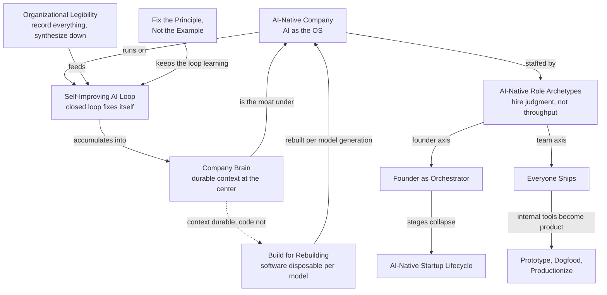

# Map - AI-Native Organizations

## Summary

Eleven pages on what a company looks like when AI is its operating system rather than a tool. [[AI-Native Company]] is the hub; three pages carry the mechanism (a [[Self-Improving AI Loop]] needs [[Organizational Legibility]] as input and fills a [[Company Brain]] as output), and the rest say who does the work and what gets rebuilt. The one idea to remember: the durable asset is recorded context, and everything else, including the software, is disposable.

## Diagram

Rendered with archify: [diagrams/map-ai-native-organizations](diagrams/map-ai-native-organizations/map-ai-native-organizations.html) (open from a local checkout).

## How it works

[[AI-Native Company]] holds the frame: AI is the operating system the company runs on, token usage replaces headcount as the binding constraint, and the intelligence layer takes over middle management's routing role. The mechanism underneath is a triangle. [[Organizational Legibility]] is the input: if an action was not recorded, it did not happen to the AI, and raw recordings must be synthesized down because no context window holds an org's history. [[Self-Improving AI Loop]] is the unit of work: a process wrapped in a closed feedback loop that fixes its own failures, with [[Fix the Principle, Not the Example]] as the rule that keeps a loop learning instead of accumulating patches. [[Company Brain]] is the output: business context and skills are the durable asset, and the accumulated context compounds into a moat.

The people pages hang off the frame. [[AI-Native Role Archetypes]] says to hire for judgment because models supply throughput, that role boundaries blur, and that every agent workflow still has a named human owner. [[Founder as Orchestrator]] and [[Everyone Ships]] are the same shift at founder and team scale: the person who understands the problem ships the first version. [[Prototype, Dogfood, Productionize]] is the path an internal tool takes to become product, and [[Build for Rebuilding]] says the software on top is discarded each model generation, which only makes sense if the context in the brain is what persists. [[AI-Native Startup Lifecycle]] remaps the four startup stages on the same premise.

## Where the tensions are

- **One intelligence layer or a mesh.** [[AI-Native Company]] says the intelligence layer replaces middle management's routing; [[Company Brain]] carries a `contested`, low-confidence claim that large organizations get a mesh of sources of truth that agents reconcile, not one layer. A source describing an org past a few hundred people would settle it.
- **Disposable software, durable context.** [[Build for Rebuilding]] and [[Company Brain]] only agree if code and context are kept strictly apart. No page states that separation as its own claim; this KB's own [[Three-Layer Architecture]] is one instance of it.
- **Roles blur, owners stay.** [[AI-Native Role Archetypes]] and [[Everyone Ships]] say boundaries dissolve and anyone ships, yet require a named human owner per workflow and say the division of labor survives past the first version. Which roles survive is not stated.
- **Thin sourcing.** [[AI-Native Startup Lifecycle]] rests on one vendor ebook, and [[Founder as Orchestrator]] and [[Everyone Ships]] on vendor-curated testimonials; their `supported` status is weaker than it reads. [[Prototype, Dogfood, Productionize]] has no claim callout at all.

## How to explain this

**In a few sentences:**

> This cluster is about companies built around AI from the start. The core loop is: record everything so the AI can see it, wrap each process in a feedback loop that fixes its own mistakes, and let what the loop learns pile up into a company brain that's the real asset. The people pages say hire for judgment, let whoever understands the problem ship, and keep a named owner on every workflow. The software on top gets rebuilt every model generation; the recorded context is what lasts.

**Likely follow-ups:**

- **What's the strongest claim here?** The two high-confidence legibility claims: unrecorded actions are invisible to the AI, and recordings must be synthesized down.
- **What's most in doubt?** Whether a big org gets one intelligence layer or a mesh; the pages disagree and the mesh claim is marked contested.
- **How does this relate to this KB?** The KB is a company brain for one domain, and its ingest loop is a self-improving loop with a human in it.
