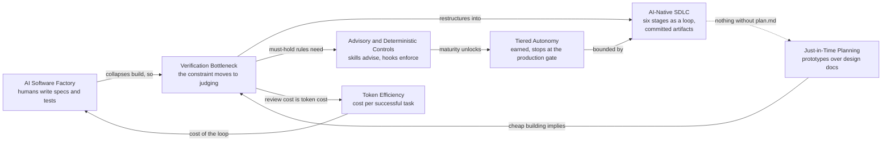

# Map - AI-Native Software Engineering

## Summary

Seven pages on what happens to software engineering when agents write the code. [[Verification Bottleneck]] is the hub every other page links to: once building collapses, the constraint moves to judging what was built. The pages around it say where the judgment goes (controls, autonomy tiers, a rebuilt lifecycle), what planning becomes, and what the whole thing costs. The one idea to remember: speed is bought with verification infrastructure, not with more agents.

## Diagram

## How it works

[[AI Software Factory]] is the premise: humans write specs and tests, agents implement until the tests pass, and the spec is the asset while the code is disposable. [[Verification Bottleneck]] is the consequence and the hub: the engineering constraint shifts from writing code to verification, review and security, and the human/AI review boundary has to be recalibrated each model generation. Three pages say where verification lives. [[Advisory and Deterministic Controls]] splits rules into the kind an agent reads (skills, instructions) and the kind that holds regardless (hooks, sandboxes, PR review): a skill makes violations rare, only a hook makes them near impossible. [[Tiered Autonomy]] scales how much an agent may do by deviation, environment, change size and trust earned, and always stops at the production gate. [[AI-Native SDLC]] rebuilds the six-stage lifecycle as a loop chained by committed markdown artifacts that are both handoff and audit trail.

[[Just-in-Time Planning]] says cheap building turns feature design docs into prototypes while durable context documents matter more. [[Token Efficiency]] prices the loop: cost per successful task is the unit, a property of the whole architecture rather than of a router.

## Where the tensions are

- **Prototype or plan.** [[Just-in-Time Planning]] carries the cluster's only `contested` claim, that prototypes replace design docs; [[AI-Native SDLC]] says nothing is implemented without an accepted `plan.md`, checked by a hook. A source on a team that tried both would settle whether the difference is stage (startup vs regulated incumbent) or disagreement.
- **Spec as asset vs agents that drift.** [[AI Software Factory]] says humans only define and judge; [[Verification Bottleneck]] and [[Advisory and Deterministic Controls]] say agents drift from architecture plausibly and must not be able to weaken their own tests. The pages do not state this tension; it is implicit.
- **Spend tokens or save them.** [[Token Efficiency]] optimizes cost per task; [[AI Software Factory]] and [[Tiered Autonomy]] describe fleets and a burn-tokens posture. [[Token Efficiency]] calls these compatible but files no claim for it.
- **Sourcing.** The lowest-confidence claim is the factory's no-hand-written-code repo, secondhand and greenfield-only; nearly every other claim is `supported / medium` and rests on Anthropic or vendor-collected sources, with one consultant as the only outside corroboration.

## How to explain this

**In a few sentences:**

> Once agents write most of the code, the hard part is no longer building, it's knowing what you built is right. So the cluster is about verification: which rules merely advise an agent and which actually stop it, how much freedom an agent earns and where that stops, and how the lifecycle gets rebuilt around committed artifacts you can audit. Planning shifts toward prototypes, and the whole loop is priced per successful task rather than per seat.

**Likely follow-ups:**

- **Which page do I read first?** [[Verification Bottleneck]]; every other page is a consequence of it.
- **Where do the pages disagree?** On planning: prototypes-first against an enforced plan document.
- **How much of this is vendor material?** Most of it; the one non-Anthropic voice is a consultant's feature list, so treat `supported` as "no one has contested it yet".
