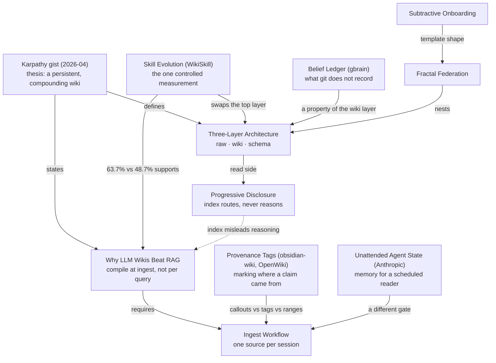

# Map - The Knowledge Layer

## Summary

Ten pages on the LLM-wiki pattern as the sources describe it, as opposed to how [[The Machinery]] implements it. [[Three-Layer Architecture]] is the hub, [[Why LLM Wikis Beat RAG]] the thesis, and [[Ingest Workflow]] the write path; the other pages are comparators that each test one part of the pattern against another implementation (WikiSkill, gbrain, obsidian-wiki, OpenWiki, Anthropic's automations). The one idea to remember: the compounding thesis has exactly one controlled measurement behind it, and every comparator so far changes the gate, not the layers.

## Diagram

Rendered with archify: [diagrams/map-the-knowledge-layer](diagrams/map-the-knowledge-layer/map-the-knowledge-layer.html) (open from a local checkout).

## How it works

[[Why LLM Wikis Beat RAG]] states the thesis: synthesis moves to ingest time, so knowledge compounds instead of being re-derived per query, and the economics are about maintenance rather than retrieval. [[Three-Layer Architecture]] is the shape that makes it safe: immutable `raw/`, an agent-owned `wiki/`, and a schema that disciplines the agent. [[Ingest Workflow]] is the write path, one source per session with the user in the loop, and [[Progressive Disclosure]] the read side: metadata and `index.md` route an agent to the right pages but are not where it reasons.

The comparators each probe one piece. [[Skill Evolution]] (WikiSkill) swaps documents for execution traces and skills for the schema, and supplies the only controlled evidence for compounding: 63.7% with a compiled wiki against 48.7% without, from one paper and one model. [[Belief Ledger]] (gbrain) asks what markdown plus git fails to record, belief history rather than file history, and the page files that as a wiki-layer property rather than a fourth layer. [[Provenance Tags]] sets obsidian-wiki's origin tags and OpenWiki's versioned evidence ranges against this KB's claim callouts. [[Unattended Agent State]] takes Anthropic's scheduled daily brief as the discipline a timer-driven `/scout` would need. [[Fractal Federation]] and [[Subtractive Onboarding]] are template design, not pattern claims: they have no sources and no callouts.

## Where the tensions are

- **Interactive gate vs mechanical maintenance.** [[Ingest Workflow]] keeps ingest interactive; the maintenance-economics claim in [[Why LLM Wikis Beat RAG]] rests on OpenWiki and WikiSkill, which maintain with no human at ingest. [[Ingest Workflow]] files the reconciliation as `speculative`: one-source-per-session is a choice of gate, not of scale.
- **Who reads the wiki.** [[Skill Evolution]] measured that giving the executing agent wiki access lowered skill quality (63.7% to 60.9%), which sits awkwardly with the read-time-asset premise of [[Why LLM Wikis Beat RAG]]. The page says the result does not decide who should read a wiki that trains nothing.
- **Index as replacement for embeddings.** [[Why LLM Wikis Beat RAG]] leans on index-first navigation; [[Progressive Disclosure]]'s obsidian-wiki measurement (44% vs 83% on graph questions) shows the index misleads reasoning and is a routing aid only.
- **Inference lint cannot see prose.** [[Provenance Tags]]'s speculative claim is that origin-mark lint only counts inference the agent admitted to, and it cites the low-confidence "bookkeeping lapse makes a wiki worse than RAG" line as the kind of claim that hides.
- **One paper carries the thesis.** Everything resting on WikiSkill is medium confidence from one paper, one model, three runs; obsidian-wiki's "2000 pages, same cost" is asserted, not shown. A second controlled study on a document corpus would move the compounding claim most.

## How to explain this

**In a few sentences:**

> This is what the sources say about the pattern the KB runs on. Karpathy's gist states it: read each source once, compile it into a wiki, and answer from the wiki so knowledge compounds. The layers make that safe because the agent can't touch the sources. Every later source we've read tests one piece: WikiSkill measured the compounding, gbrain asked what git doesn't record, obsidian-wiki and OpenWiki mark provenance differently, and Anthropic's automations show what running it unattended would take.

**Likely follow-ups:**

- **Is compounding actually measured?** Once, in WikiSkill, on benchmark agents rather than documents; everything else is practice and testimony.
- **Where does this KB differ from the comparators?** On the gate: it keeps a human at ingest where WikiSkill, obsidian-wiki and OpenWiki run batch or CI.
- **Which pages have no evidence?** [[Fractal Federation]] and [[Subtractive Onboarding]]; they describe the template, not the sources.
