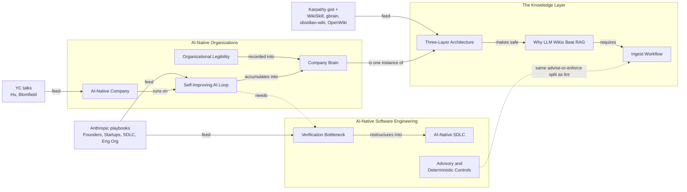

# The Knowledge Map

## Summary

The wiki holds twenty-seven concept pages, one synthesis, and twelve people, fed by thirteen raw sources, and they fall into three clusters: how AI-native organizations work, how software engineering changes when agents write the code, and what the sources say about the LLM-wiki pattern this KB runs on. The clusters share sources more than they share pages: the same Anthropic playbooks and YC talks feed the first two, and the third is the self-referential one. The one idea to remember: [[Verification Bottleneck]], [[Company Brain]] and [[Three-Layer Architecture]] are the three hubs, and each cluster's thesis rests on fewer independent sources than its page count suggests.

## Topics

- [[Map - AI-Native Organizations]]: what does a company look like when AI is its operating system, and what is the durable asset?
- [[Map - AI-Native Software Engineering]]: once agents write the code, where does the engineering constraint move, and what holds a rule?
- [[Map - The Knowledge Layer]]: what do the sources say about compile-at-ingest wikis, and how much of it is measured?

## Diagram

Rendered with archify: [diagrams/the-knowledge-map](diagrams/the-knowledge-map/the-knowledge-map.html) (open from a local checkout).

## How it works

The organizations cluster is the largest and hangs off [[AI-Native Company]]: a loop that needs legibility as input and fills a company brain as output, plus the people and lifecycle pages around it. The software-engineering cluster hangs off [[Verification Bottleneck]]: once building collapses, every other page is about where judgment goes. The knowledge-layer cluster hangs off [[Three-Layer Architecture]] and is the KB describing its own pattern from the outside: a thesis page, a write path, and comparators that each test one piece against another implementation.

The bridges between clusters are three. [[Company Brain]] is the org-side name for what [[Three-Layer Architecture]] builds for one domain. [[Self-Improving AI Loop]] needs the verification the engineering cluster describes before it can run unattended. [[Advisory and Deterministic Controls]] is the same advise-or-enforce split that [[Ingest Workflow]] and lint make in this KB.

## Where the tensions are

Each cluster page carries its own. The ones that cross clusters:

- **The organizations cluster and the engineering cluster share most sources**, so agreement between them is one vendor's view twice, not corroboration. The only outside voices are two YC talks and one consultant's feature list.
- **Unattended loops.** [[Self-Improving AI Loop]] claims a monitored loop fixes itself overnight; [[Ingest Workflow]] and [[Unattended Agent State]] say this KB keeps a human at the gate and names what a timer would need first. Both are true of different systems; no page says when a knowledge loop earns the timer.
- **What is measured.** The engineering cluster has no controlled evidence; the knowledge-layer cluster has one paper. Most `supported` claims across the wiki mean "no source has contested this yet".

## How to explain this

**In a few sentences:**

> The wiki is about three things. How a company runs when AI is its operating system, where recorded context is the asset. What happens to software engineering when agents write the code, which is that verification becomes the bottleneck. And the wiki pattern itself, as the sources describe it: compile knowledge once at ingest and answer from the result. The first two mostly come from the same Anthropic and YC material; the third is the KB reading about its own design.

**Likely follow-ups:**

- **Where do I start?** The three hubs: [[AI-Native Company]], [[Verification Bottleneck]], [[Three-Layer Architecture]].
- **What's the weakest part?** Source independence; most claims trace to one vendor's playbooks.
- **What would change the map most?** A non-vendor account of an AI-native org at scale, and a second controlled study of a compiled wiki.
