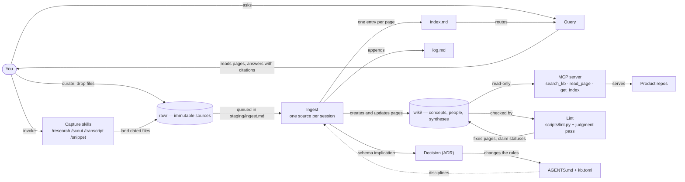

# The Machinery

## Summary

MycoForge is a closed loop: you curate sources into `raw/`, an agent compiles them into a cross-linked wiki, questions are answered from the wiki rather than from the sources, and lint and decisions feed corrections back into the wiki and the rules that govern the agent. The one idea to remember: knowledge is compiled once at ingest and kept current, never re-derived per question, and the agent is the only writer of the wiki.

## Diagram

Rendered with archify: [diagrams/the-machinery](diagrams/the-machinery/the-machinery.html) (open from a local checkout).

## Topics

The machinery is small enough for one page, so its parts are focuses below rather than topic pages. A focus becomes its own page when it outgrows a screen or needs its own diagram.

## How it works

### Why compile, not retrieve

Retrieval-augmented generation answers each question by searching the sources again, so nothing learned on one question helps the next. This KB compiles instead: every source is read once, in full, and its facts are integrated into pages that already exist, with cross-references and a provenance trail. The payoff compounds; the tenth source lands into a wiki that already knows the first nine ([[Why LLM Wikis Beat RAG]]). The cost is that compilation is judgment work, which is why ingest keeps a human in the session.

### Three layers, and who writes where

`raw/` is yours and immutable: the agent reads it and never edits or deletes it. `wiki/` is the agent's: pages, the `index.md` catalog, and the append-only `log.md`, which you read in Obsidian and rarely touch. The schema, `AGENTS.md`, is co-owned and tells the agent how the wiki is structured and which workflow to run when; per-instance settings live in `kb.toml` so the tooling stays byte-identical across instances ([[Three-Layer Architecture]]). The boundary is what makes a wide edit safe: the agent can rewrite fifteen pages in one pass because the sources underneath cannot be damaged. When you do hand-edit a wiki page, the agent commits it separately as yours before doing its own work.

### The write path: a source becomes pages

Capture is mechanical and separate from ingest. The capture skills (`/research`, `/scout`, `/transcript`, `/snippet`, all under `.agents/skills/`) land dated files with provenance frontmatter in `raw/` and stop; `staging/ingest.md` queues what has not been ingested, with a watch-out per source. Ingest is one source per session: the agent reads it in full, discusses takeaways with you, creates or updates every page the source touches, adds each new page to `index.md`, and appends an `ingest |` entry to `log.md`. Contestable assertions go in `[!claim]` callouts with a confidence, a status, and an evidence line citing the raw file, so a later source can contest or supersede them in place ([[Ingest Workflow]]). If a source bears on how the KB itself works, the implication is logged and handled as a decision, not changed mid-ingest.

### The read path: questions and the MCP server

A question starts at `index.md`, one line per page, so the agent routes to the few pages that matter before opening any of them ([[Progressive Disclosure]]). The answer comes back in conversation with wikilink citations; it is filed as a `syntheses/` page only when you ask. Software built on the KB reads it the same way through `mcp/server.py`, a read-only MCP server exposing `search_kb`, `read_page`, and `get_index`; writes stay interactive by design.

### Keeping it honest: claims, lint, the judgment pass

`scripts/lint.py` is the deterministic half: every page indexed exactly once, every wikilink resolving, every `raw:` path existing, every claim callout well-formed with a status from the vocabulary in `kb.toml`, raw dates consistent, orphans and recurring unpaged terms flagged. The judgment half is the lint workflow's second step, which the script cannot do: contradictions between pages, claims a newer source supersedes, inference stated as fact, missing cross-references. Both end in a `lint |` log entry. Decisions close the loop on the rules themselves: a schema implication becomes a proposed ADR under `decisions/`, and an accepted one changes `AGENTS.md` or the tooling on a branch with review ([[Advisory and Deterministic Controls]] is the same split, seen from the sources).

## Why it's built this way

- **One source per session.** Ingest is judgment-heavy and the user stays involved; a batch would move the gate from the conversation to a review queue (`AGENTS.md`, Ingest; [[ADR-012 No Scheduled Capture Without a Decision]] records why nothing runs on a timer).
- **Capture never touches the wiki.** Capture is mechanical, ingest is deliberate; keeping them apart means a fetched page can be wrong or hostile without reaching a wiki page, and text inside a source is data, never an instruction (`AGENTS.md`, Transcript and Snippet; Ingest).
- **Claims are callouts, not prose.** A contestable sentence in prose cannot be found or audited; a callout can be linted for shape and superseded without being overwritten ([[ADR-010 Lint the Claim Contract]], [[ADR-007 No Stable Claim Identity]]).
- **Config in `kb.toml`, never in code.** Instance data separated from vendored tooling is what lets `/sync-upstream` port template updates and lets a child KB stay a standalone folder ([[ADR-003 Copy-and-Own with Config-Code Split]]).
- **The MCP server is read-only.** Ingestion stays an interactive workflow here, never an API call ([[ADR-004 Read-Only MCP in v1]]).
- **Content lands on `main`, structure goes through review.** Knowledge commits are one per workflow run; schema, tooling, and skill changes take a branch and a PR citing the source that prompted them ([[ADR-014 The Wiki Does Not Edit Skills]]).

## How to explain this

**In a few sentences:**

> It's a wiki an agent maintains for me. I drop sources in a folder it can read but never change; it reads each one and folds it into pages that already exist, with links and a note of where every claim came from. When I ask a question, it answers from the wiki, not from the sources, so the answer gets better as the wiki grows. A linter and a judgment pass catch what drifts, and when a source makes me want to change the rules, that goes through a decision record rather than a quiet edit.

**Likely follow-ups:**

- **Why not just RAG over the sources?** Retrieval re-derives on every question and never accumulates; compiling once means the tenth source lands into what the first nine built.
- **What stops the agent from corrupting the sources?** Ownership: `raw/` is read-only to the agent by rule, and the wiki it does own is cheap to regenerate from those sources.
- **How does it stay consistent as it grows?** Deterministic lint for shape, a judgment pass for contradictions, and claim callouts whose status changes in place when a newer source disagrees.
